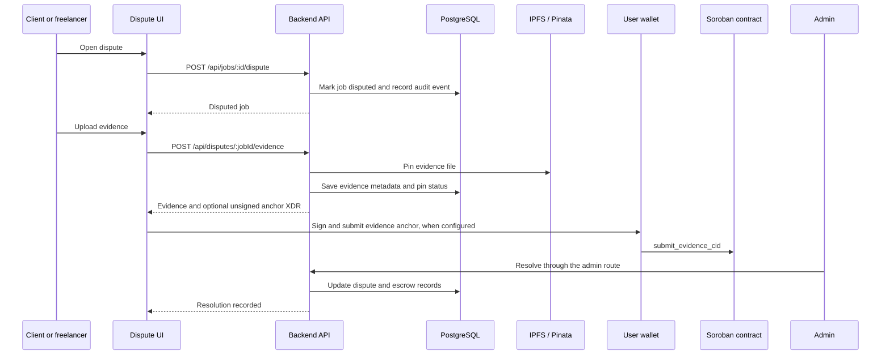

# Dispute resolution

This is the canonical guide to dispute handling in Stellar MarketPay. It
distinguishes the backend's database workflow from the Soroban contract's
 on-chain dispute functions: the backend routes do not currently invoke the
 contract's `resolve_dispute` entry point.

## Current application workflow

### Open a dispute

`POST /api/jobs/:id/dispute` is implemented in
`backend/src/routes/jobs.js` and `backend/src/services/jobService.js`. The
authenticated route changes an in-progress job to `disputed`, stores the reason
and description, writes an audit record, and notifies the job participants.
The current route does not verify that the requester is a job participant; its
service checks the job status only. This is a database workflow; it does not
call Soroban `raise_dispute`.

The separate `disputeService.createDispute` workflow stores a row in the
`disputes` table and verifies that the caller is a job participant. These
records and the job status are related application data, but they are not an
on-chain transaction.

### Submit evidence

`POST /api/disputes/:jobId/evidence` accepts multipart uploads from a job
participant while the dispute is open. The backend allows up to 10 evidence
files per party and limits each file to 5 MiB. The route also restricts the
accepted MIME types. The service pins the file through Pinata, validates its
CID, and stores the file metadata and pin-verification result in
`dispute_evidence`.

When Soroban evidence anchoring is configured, the response can include
unsigned XDR for `submit_evidence_cid`. The frontend must have the user sign
and submit that transaction. The backend does not submit it on the user's
behalf. A failed or unavailable anchor does not discard the stored evidence.
`GET /api/disputes/:jobId/onchain-cids` reads the contract's CID audit trail.
Evidence download uses a short-lived signed proxy URL; the proxy checks the
token and stored CID before streaming the file from IPFS.

### Record a resolution in the application

The admin route `PATCH /api/admin/disputes/:jobId/resolve` requires the admin
role and 2FA. It updates the escrow and job records, records a dispute timeline
event, and writes audit entries. The `disputeService.resolveDispute` path
supports `release_funds` and `refund_client`, records the dispute result in the
database, and schedules reputation recalculation. Neither backend path invokes
the contract's `resolve_dispute` entry point. The older
`POST /api/jobs/:id/resolve` route reopens the job by changing its status back
to `in_progress`.

## Soroban contract workflow

The MarketPay contract exposes a separate on-chain workflow in
`contracts/marketpay-contract/src/disputes.rs`:

1. `raise_dispute` requires the caller's authorization and requires the caller
   to be the escrow client or freelancer. It changes the escrow to `Disputed`.
   If an admin configured a nonzero dispute bond, it also locks and records the
   bond. Otherwise, the legacy zero-bond path is used.
2. `resolve_dispute` requires authorization from the configured arbitrator
   (`DataKey::ArbitratorAddress`) and an escrow in `Disputed` state. The winner
   must be one of the two escrow participants. The contract validates the
   split and fee, pays the arbitrator fee and participant split, settles any
   stored bond, and emits resolution events.

The contract only accepts its configured arbitrator address for this entry
point. Backend admin permissions and the separate DAO arbitrator registry do
not change that contract authorization rule. The DAO registry and voting data
are used by other application features; the on-chain dispute entry point is
not a 2-of-3 voting flow.

## Code and data map

| Layer | Source | Responsibility |
|---|---|---|
| Job dispute route | `backend/src/routes/jobs.js` | Accepts dispute requests and exposes the older job-resolution route |
| Job service | `backend/src/services/jobService.js` | Updates job status, audit records, and participant notifications |
| Evidence API | `backend/src/routes/disputes.js` | Upload and retrieve evidence; issue short-lived download URLs |
| Evidence service | `backend/src/services/disputeService.js` | Participant checks, evidence records, event history, and database resolution |
| IPFS | `backend/src/services/ipfsService.js` | Pins evidence and verifies the Pinata pin |
| Soroban evidence | `backend/src/services/sorobanEvidence.js` | Builds unsigned XDR and reads the on-chain CID list |
| Admin resolution | `backend/src/routes/admin.js` | Updates application records and admin audit data |
| Contract dispute logic | `contracts/marketpay-contract/src/disputes.rs` | On-chain dispute authorization, payout split, bond settlement, and events |

Relevant tables are `jobs`, `disputes`, `dispute_evidence`, `dispute_events`,
and `escrows`. The `dao_arbitrators` table belongs to the separate arbitrator
registry and voting feature.

## Related documentation

- [FAQ: Disputes & Refunds](FAQ.md#disputes--refunds)
- [IPFS / Pinata evidence storage](ipfs-setup.md)
- [Contract API reference — disputes and arbitration](contract-api-reference.md)
- [Contract errors — dispute codes](contract-errors.md)
- [Escrow lifecycle and architecture](architecture.md)
- [Environment variables](environment-variables.md)
